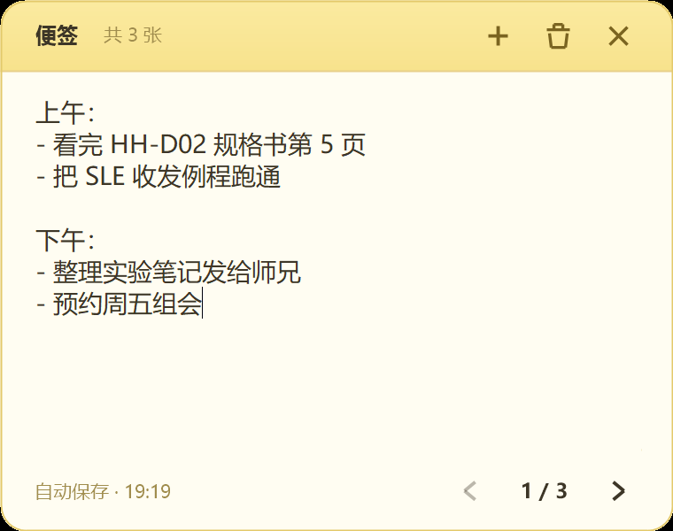

# 桌面便签 · Sticky Notes

一块常驻桌面的便签纸：随手写、翻页看、一键新建 / 删除，停手即自动保存。



## 启动

| 方式 | 操作 |
| --- | --- |
| 推荐 | 双击 `启动便签.vbs`（静默启动，不闪黑框） |
| 备选 | 右键 `StickyNotes.ps1` →「使用 PowerShell 运行」 |
| 命令行 | `powershell -ExecutionPolicy Bypass -File StickyNotes.ps1` |

第一次出现在屏幕右侧中部，之后自动记住位置。只允许一个实例，重复启动会静默退出。

## 怎么用

| 操作 | 效果 |
| --- | --- |
| 直接打字 | 写当前这张便签，停手 0.7 秒自动保存 |
| 拖顶部黄带 / 底部空白 | 移动位置，松手后记住 |
| 拖四条边或四个角 | 自由改变便签大小（最小 260×170），松手后记住 |
| `Ctrl+滚轮` / `Ctrl+=` / `Ctrl+-` | 放大 / 缩小字号（9–30），立即生效并记住 |
| `Ctrl+0` | 字号恢复默认（14） |
| **＋** | 在当前便签**后面**插入一张空白便签并切换过去 |
| **🗑** | 删除当前便签（有内容会先确认；只剩最后一张时改为「清空」） |
| **×** | 保存并关闭 |
| **‹ ›** 或 `Alt+← / Alt+→` | 上一张 / 下一张，到两端时箭头变灰 |
| `Alt+N` / `Alt+Del` | 新建 / 删除便签 |
| 右键 | 新建、删除、翻页、字号 + / − / 重置、大小重置、复制、粘贴、全选、始终置顶、退出 |

小细节：

- 便签为空时显示浅色提示文字，点一下就能开始写
- 内容少不显示滚动条，写长了才出现
- 大小和字号随时可调，下次启动保持上次的样子
- 翻页、新建、删除都会立刻落盘，不会丢内容

## 数据文件

同目录的 `notes.json`（自动生成，明文 JSON，可手改）：

```json
{
  "x": 2320,
  "y": 652,
  "w": 380,
  "h": 300,
  "font": 14,
  "topmost": true,
  "current": 0,
  "notes": [
    { "text": "上午：\n- 看完 HH-D02 规格书第 5 页\n\n下午：\n- 整理实验笔记" },
    { "text": "记得买：牛奶、鸡蛋。" }
  ]
}
```

- `current` 是当前页码，从 `0` 开始
- 文本里的换行在 JSON 中写作 `\n`
- `w` / `h` 是窗口大小、`font` 是字号（逻辑像素，高 DPI 屏自动放大）
- 窗口位置、大小、字号、置顶状态也记在这个文件里

## 说明

- 只用系统自带的 Windows PowerShell 5.1，**不需要安装任何依赖**
- 自动适配屏幕缩放（本机 3200×2000 @200% 已验证）
- 出问题看 `sticky.log`；加 `-Trace` 参数运行会记录启动与保存细节

## 文件

| 文件 | 用途 |
| --- | --- |
| `StickyNotes.ps1` | 主程序（窗口、绘制、翻页、存储） |
| `启动便签.vbs` | 静默启动器 |
| `notes.json` | 便签数据（自动生成） |
| `preview.png` | 效果预览 |
